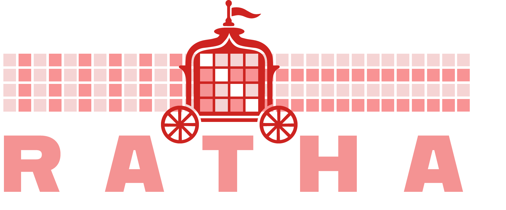

<p align="left">
  
</p>

[](https://solderpad.org/licenses/SHL-0.51/)
[](https://www.apache.org/licenses/LICENSE-2.0)
[](https://github.com/pulp-platform/datamover/actions/workflows/gitlab-ci.yml?query=branch%3Alkesting%2Fkonark)
[](https://iis-git.ee.ethz.ch/github-mirror/datamover/-/jobs/artifacts/lkesting%2Fkonark/browse/simulation/vcs/cov/default/urgReport?job=coverage-default)

**Ratha** (formerly Datamover) is an HWPE that reads a tensor from TCDM, transforms it, and writes
the result to another TCDM region. It transposes, converts to and from the block layout (column
blocks of one beat), unfolds and folds MobileViT patches, and makes im2col operands. The repository
holds the RTL, a Python golden model, and an Ibex testbench with JSON test suites.

## Quick start

```bash
uv sync --python 3.11
source .venv/bin/activate
bender-0.31.0 checkout
make run-all-tests
```

`make run-all-tests` loads the `riscv` environment. Prefix a single-test command with `riscv`.

## Repository structure

| Path | Content |
|---|---|
| `rtl/` | `datamover_top{_wrap}`, engine, im2col unit, element buffer, streamer, `datamover_pkg` |
| `rtl/ctrl/` | Register map (`datamover_regif.rdl`), control (`datamover_ctrl.sv`), generated register file (`regif/`, `make regif`) |
| `rtl/verif/` | Testbench (`tb_datamover.sv`, `tb_dummy_memory.sv`) |
| `sw/` | HAL (`datamover_hal.h`, `datamover_config.h`) and the testbench program |
| `datamover_model/` | Golden model, workload parser and validator, test runner |
| `configs/`, `tests/` | HW profiles (`hw_configs.json`) and JSON test suites |
| `mk/` | HW config and test flow, Questa, VCS with coverage, SpyGlass lint |
| `util/lint/` | SpyGlass script and report check |

## Hardware parameters

`datamover_top` has HCI ports, `datamover_top_wrap` has flat ports. `datamover_pkg` holds every
default.

| Parameter | Default | Meaning |
|---|---|---|
| `Bandwidth` | 576 | TCDM port width in bits, a multiple of the word width |
| `ElemsPerWord`, `ElemWidth` | 8, 8 | Elements per memory word; element width in bits (8, 16, or 32) |
| `MisalignedAccesses` | 1 | Accesses that start inside a word; the realignment takes one word of the port |
| `NumCores`, `NumContext`, `IdWidth` | 8, 2, 10 | Event targets, job queue depth, peripheral ID width |
| `AddrWidth` | 32 | TCDM address width (wrapper only) |
| `EnableIm2col`, `EnableBuffer` | 1, 1 | Build the im2col unit; build the element buffer (transpose, unfold, fold) |
| `Im2colKernel`, `Im2colMinLog2W` | 3, 3 | Largest im2col kernel side (odd, 3 to 7); log2 of the smallest image row width |
| `FifoDepth` | 2 | Depth of the engine stream FIFOs |

One beat holds `(Bandwidth - (MisalignedAccesses ? word : 0)) / ElemWidth` elements. The beat is the
block width of the block layout and the widest im2col row. Pointers and TCDM addresses count bytes;
strides and lengths count elements.

`HW_CONFIG` selects a profile of `configs/hw_configs.json` for the testbench, the HAL, and the
validator:

| Profile | Bandwidth | Word | Element | Misaligned | Features | Elements per beat | CI |
|---|---|---|---|---|---|---|---|
| `bw128_w32` | 128 | 32 | 8 | no | | 16 | yes |
| `bw256_w64` | 256 | 64 | 8 | no | `IM2COL_KERNEL` 5 | 32 | yes |
| `default` | 576 | 64 | 8 | yes | | 64 | yes |
| `bw128_w32_nobuf` | 128 | 32 | 8 | no | `ENABLE_BUFFER` 0 | 16 | no |
| `bw256_w64_e16` | 256 | 64 | 16 | no | | 16 | no |
| `bw256_w64_k7` | 256 | 64 | 8 | no | `IM2COL_KERNEL` 7 | 32 | im2col |

## Operating modes

| `DATAMOVER_MODE` | Operation |
|---|---|
| 0 | Copy |
| 1 | Transpose of 1, 2, or 4 element groups (`TRANSP_MODE`) |
| 2 | Block layout, forward or reverse (`BLOCK_MODE`) |
| 3 | Block layout transpose |
| 4, 5 | Unfold and fold of 2x2 patches, `LAYOUT` CHW or BLOCK |
| 6 | im2col: the im2col unit (K x K, stride 1, border K / 2, BLOCK input), the stride-2 merge, a pass-through for other kernels, and im2row (`ROW_BLOCK`) for kernel == stride |

## HAL

`sw/datamover_hal.h` is header-only. Define `DATAMOVER_BASE_ADDR` and the `DATAMOVER_*` build macros
(see `sw/sw.mk`) before the include.

```c
datamover_task_config_t task = { .mode = DATAMOVER_BLOCK_LAYOUT, .in_ptr = src, .out_ptr = dst,
                                  .size_c = 1, .size_m = 196, .size_n = 768, .block_mode = 0 };
if (datamover_run(&task) != DATAMOVER_OK) { /* the build cannot serve this shape */ }
datamover_wait();
```

`datamover_run` returns `DATAMOVER_ERR` for a job the build cannot serve.

## Limits

- Without misaligned accesses, every strided row starts and ends on a word.
- The im2col unit takes an odd K from 3 to `Im2colKernel`, stride 1, a border of K / 2, and a row
  width that is a power of two from `2**Im2colMinLog2W` to the beat.
- The stride-2 merge reads a pre-padded row-major image, with `W_out` a multiple of the beat.
- HWC im2row needs a 64-element beat.
- Matrix sizes are 16 bits wide. A transpose with more than one channel runs one job per channel.

`datamover_model/workloads/suite.py` checks the same rules and skips a test entry that the profile
cannot serve.

## Tests

```bash
make tests TEST_JSON=tests/block.json PARALLEL=8                # one suite
make tests TEST_JSON=tests/block.json TEST=<NAME> GUI=1         # one test in the Questa GUI
make tests TEST_JSON=tests/block.json HW_CONFIG=bw128_w32       # one suite on another profile
riscv make test-transpose SIZE_M=64 SIZE_N=128 TRANSP_MODE=2    # one job without JSON, see mk/config.mk
make gen-tests                                                  # sweeps of tests/specs/ per profile
```

Each test runs in `simulation/tests/<TEST_NAME>/`; the reports go to `reports/`. A suite with its
own `hw_config` runs on that profile only. `tests/control.json` (`CTRL_TEST=1`) also checks the
control target: register read-back, read-only writes, a byte store, autotrigger, and a soft clear
during a job.

The CI runs every portable suite and sweep on the three CI profiles. The `default` jobs run on VCS
with coverage, the others on Questa.

## Lint

```bash
make spyglass
```

`make spyglass` lints `datamover_top_wrap` with SpyGlass (`lint/lint_rtl`). A violation in `rtl/`
fails the check; the dependencies are counted but do not fail it.

## Code coverage

```bash
make tests TEST_JSON=tests/konark_ci.json ENGINE=vcs COV=1
make vcs-cov-report
# open simulation/vcs/cov/default/urgReport/dashboard.html
```

One report covers one HW config. In the CI, each test job exports its database
(`make vcs-cov-export COV_NAME=<suite>`), and the `coverage-default` job merges them.
`simulation/vcs/cov.cfg` limits the coverage to `tb_datamover.i_dut`.

## Cleanup

```bash
make clean        # build artifacts and reports
make clean-all    # also .bender
```

## Contributors

- Francesco Conti, University of Bologna (*f.conti@unibo.it*)
- Arpan Suravi Prasad, ETH Zurich (*prasadar@iis.ee.ethz.ch*)
- Sergio Mazzola, ETH Zurich (*smazzola@iis.ee.ethz.ch*)
- Cyrill Durrer, ETH Zurich (*cdurrer@iis.ee.ethz.ch*)
- Lionnus Kesting, ETH Zurich (*lkesting@iis.ee.ethz.ch*)

## License

- *Software*: Apache License Version 2.0 (`LICENSE.sw`)
- *Hardware*: Solderpad Hardware License Version 0.51 (`LICENSE.hw`)
